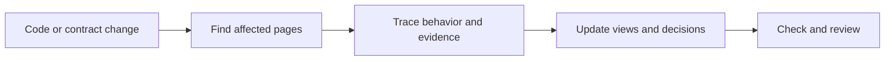

# Archlens

**Understand how a project works, how its data moves, and why its design exists.**

Archlens is a Claude Code plugin for clear, evidence-based architecture documents.
It uses Mermaid diagrams, decision records, and a writing style inspired by Simplified Technical English.
It updates the pages affected by a change instead of regenerating a large wiki.

## Install

You need a current [Claude Code](https://code.claude.com/docs/en/quickstart) installation and Git.
Run these commands **inside Claude Code**:

```text
/plugin marketplace add tushar-mahalya/archlens
/plugin install archlens@archlens
```

Choose **user scope** to use Archlens across your projects on this machine.
Reload plugins or restart Claude Code if it asks you to.
Then open the project you want to understand and run:

```text
/archlens:setup
```

No separate API key, Python installation, Node installation, or server is required for these commands.
Claude Code's normal subscription or API usage still applies.

## Five commands

| Command | What it does | Changes files? |
|---|---|---|
| `/archlens:setup` | Creates a small handbook from source evidence | Documentation only |
| `/archlens:update main` | Reviews branch and working-tree changes; updates affected views | Documentation only |
| `/archlens:check` | Checks documents, evidence, coverage, and clarity | No |
| `/archlens:explain order submission` | Traces a named scenario with a diagram and source links | No |
| `/archlens:decide use a durable queue` | Drafts a decision record with options and tradeoffs | Documentation only |

Replace `main` with your actual local base ref.
Without a ref, `update` reviews working-tree changes only.
Supply decision evidence explicitly: an isolated task does not receive your earlier conversation.

## What you get

```text
docs/architecture/
  README.md        Reading path, coverage, and known gaps
  context.md       Users, boundaries, and external systems
  containers.md    Main units and responsibilities
  runtime/         Important execution paths and failure behavior
  data/            Ownership, transformations, and lifecycle
  decisions/       Design choices, alternatives, and consequences
  glossary.md      Consistent project terms
  map.json         Source-to-document review map
```

Archlens starts small. It does not create every page or claim to trace every possible execution.
It reuses an existing documentation layout where practical.



Read the [working example](examples/order-service/README.md) to see the result before you install.

## Designed for small context

- **Explicit invocation:** no Archlens skill description enters normal model context under current Claude Code behavior.
- **Isolated task:** exploration stays outside the parent conversation; a short result returns.
- **Conditional references:** commands read only the rules and template sections they need.
- **Bounded tool output:** optional checker summaries have a tested 6,000-byte limit with explicit omission counts.
- **No always-on hooks, custom agents, MCP servers, eager imports, or shell injection.**
- **Size tests:** CI rejects oversized command prompts and shared instructions.

Current command bodies plus the shared contract are roughly 820-1,000 tokens using a bytes/4 estimate.
This is **not measured Claude token usage**. Source reads, task-specific references, host instructions, and outputs are additional.
Isolation reduces parent-context growth; it does not make the worker free.

See [context architecture and budgets](docs/context-efficiency.md), including limits and a real-task measurement plan.

## Global preferences

Create `~/.claude/archlens.json` to set your defaults:

```json
{
  "docsRoot": "docs/architecture",
  "styleTarget": 0.8,
  "maxDiagramNodes": 12,
  "maxSequenceParticipants": 7
}
```

A project's `.archlens.json` overrides these values.
You can select another user config with `ARCHLENS_CONFIG`.
These are Archlens conventions, not native Claude Code settings.
See [configuration](docs/configuration.md).

## Optional local checks

With Python 3.10+ and a clone of this repository:

```text
python plugins/archlens/scripts/archlens.py check --root /path/to/project
python plugins/archlens/scripts/archlens.py impact --root /path/to/project --base main
python plugins/archlens/scripts/archlens.py config --root /path/to/project --json
```

On Windows, use a quoted Windows path such as `"C:\work\my-project"`.
The Python tool has no third-party dependencies and does not edit your project.
Use `--summary` for bounded JSON or `--json` for the complete report.
The [CLI reference](docs/cli.md) explains checks, exit codes, and limitations.

## Trust and limits

- The writing target is **STE-inspired**, not official ASD-STE100 certification.
- Code proves implementation, not undocumented human intent.
- Proposed decisions need human approval.
- Rendered diagrams can still be wrong. Check them against evidence.
- The optional checker does not render Mermaid or calculate an STE score.
- Archlens has no telemetry or remote rendering. Claude Code processes selected content under its own data policy.
- Instructions guide behavior; they are not a security sandbox. Normal permissions still apply.

## More help

- [Installation, updates, removal, and troubleshooting](docs/installation.md)
- [Documentation method and research](docs/methodology.md)
- [How Archlens works](docs/architecture/README.md)
- [Contributing and tests](CONTRIBUTING.md)
- [Release notes](CHANGELOG.md)

MIT licensed. Independent project; not affiliated with Anthropic or ASD.
