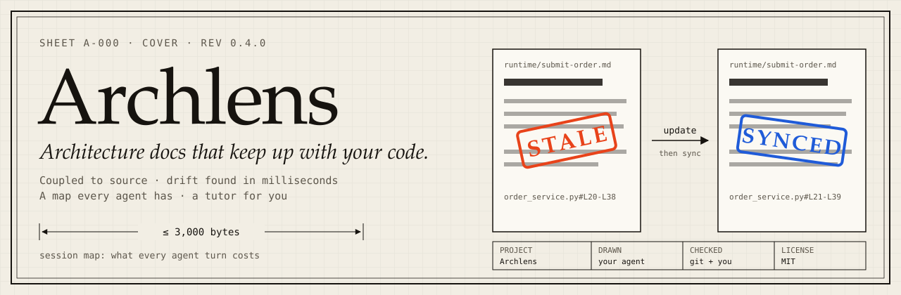
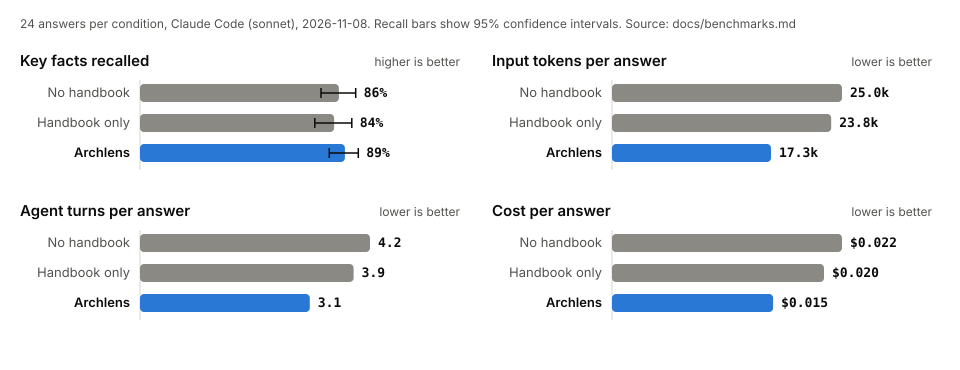
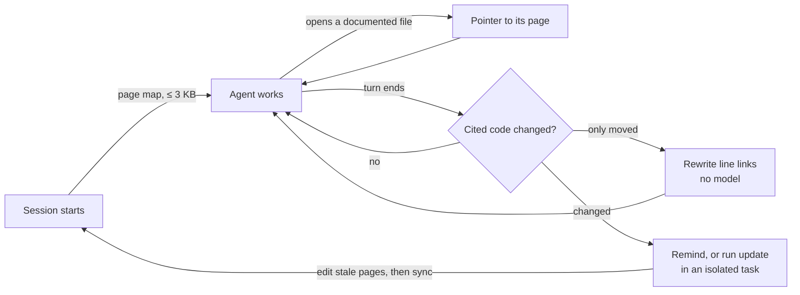

<p align="center">
  
</p>

<p align="center">
  <a href="https://github.com/tushar-mahalya/archlens/actions/workflows/ci.yml"></a>
  <a href="https://github.com/tushar-mahalya/archlens/releases/latest"></a>
  <a href="https://scorecard.dev/viewer/?uri=github.com/tushar-mahalya/archlens"></a>
  <a href="LICENSE"></a>
  <a href="https://www.conventionalcommits.org/"></a>
  
</p>

<p align="center">
  <b><a href="https://archlens-docs.pages.dev/">Website</a></b> ·
  <a href="#quick-start">Quick start</a> ·
  <a href="docs/benchmarks.md">Benchmarks</a> ·
  <a href="examples/order-service/README.md">Example</a> ·
  <a href="docs/automation.md">Automation</a>
</p>

# Archlens: living architecture docs for Claude Code and AI coding agents

**Archlens keeps a small architecture handbook in step with your code, gives your coding agent
a map of the whole project in a few hundred tokens, and teaches you the codebase while you work.**
It runs as a Claude Code plugin and as a portable Agent Skill for Codex, Cursor, GitHub Copilot,
Gemini CLI, OpenCode, and other agents.

## Why Archlens

| What goes wrong today | What Archlens does | Measured |
|---|---|---|
| Docs go stale a week after they are written | Fingerprints the exact functions and line ranges each page cites, and flags the page when that code changes, even after a commit | Checks 50,000 files in **0.20 s** |
| Moved code breaks every `#L120` link | Rewrites links whose cited code only moved, or whose file was renamed. No model, no tokens | Automatic after each Claude turn |
| Agents re-explore the repository every session | Loads a compact page map at session start, or writes it into `AGENTS.md` | **408 tokens** for this repo; capped at 3,000 bytes |
| Context files bloat every turn | One model-visible description; everything else loads only when used | **178 bytes** in every session |
| AI wikis invent plausible details | Every claim links to source, tests, or decisions. Unknowns stay unknown. A checker catches dead links, moved anchors, and vanished symbols | 0.04 wrong claims per answer in our benchmark |
| You ship code you do not understand | `/archlens:learn` answers questions, gives a tour, quizzes you, and explains your branch | Inline, so you can ask follow-ups |

## Results

In 72 real Claude Code sessions answering architecture questions about this repository,
agents with Archlens answered **at least as well** (89% of key facts, against 86% without a
handbook) while using **31% fewer input tokens, 26% fewer turns, and 32% less money**.
A handbook without Archlens saved almost nothing, because the agent rarely looked for it.

<p align="center">
  
</p>

Our first version did worse: agents read a page summary and stopped there (80% recall).
We changed the map to say that source is authoritative, and published that run too.
One small repository and 24 answers per condition; see [benchmarks](docs/benchmarks.md) for method, raw data, and limits.

## Quick start

### Claude Code

```text
/plugin marketplace add tushar-mahalya/archlens
/plugin install archlens@archlens
/archlens:setup
```

That is all. Setup writes a handbook under `docs/architecture/`, records a freshness baseline,
and from then on the plugin keeps it in step with your edits. If the project already has
architecture docs, setup adopts them in place: it maps them, fixes statements the code
contradicts, and tracks them from then on. Run `/archlens:setup new` for a separate handbook instead. Choose **user scope** when asked,
so Archlens works in every project. Python 3.9+ on `PATH` as `python3` enables the hooks and
checks (the macOS system Python works); the commands still run without it.

### Codex, Cursor, Copilot, Gemini CLI, and other agents

```text
npx skills@1.7.6 add tushar-mahalya/archlens --skill archlens --agent codex --copy --yes
```

Replace `codex` with `cursor`, `github-copilot`, `gemini-cli`, `opencode`, `roo`, or `devin`.
Then ask your agent: *"Use the Archlens skill to set up architecture documentation for this project."*
Setup offers to write the page map into `AGENTS.md`, which these agents read every session.
See the [installation guide](docs/installation.md) for global installs, updates, and host caveats.

### Any editor: Git and CI checks

```yaml
# .pre-commit-config.yaml
repos:
  - repo: https://github.com/tushar-mahalya/archlens
    rev: v0.4.0
    hooks:
      - id: archlens-check   # links, anchors, diagrams, stale references
      - id: archlens-stale   # on pre-push: fail while cited code changed
```

## How it works



1. **Pages cite evidence.** A page links to source, often with a line range such as
   `order_service.py#L20-L38`. For Python, Archlens records the syntax tree of the function
   around that range, so comments and formatting do not count and a moved function is followed.
2. **`sync` records a baseline** of every cited range and covered file after someone checks a page.
3. **`status` compares** current code with that baseline. Cited evidence that changed makes a page
   `stale`. Changes elsewhere in covered files only mark it for `review`.
4. **Hooks close the loop** in Claude Code. Session start loads the map, opening a documented file
   names its page once, and the end of each turn fixes moved links and reports stale pages.
   By default (`"autoUpdate": "commit"`), when the agent commits, Archlens holds the commit once,
   the agent runs the update in an isolated task, and the docs land in the same commit as the code.

What the agent sees at session start (real output from the [example](examples/order-service/README.md)):

```text
## Architecture handbook (Archlens)
Pages live in `docs/architecture/` (6 pages, 0 stale). Use them to find the right code fast and
to learn why it is built this way. Pages summarize; source is authoritative: confirm names, limits,
and behavior in the linked source before you answer or change code. ...

- `README.md` Understand the order example: The library stores an order and returns its ID. [covers order_service.py]
- `runtime/submit-order.md` What happens when the caller submits an order?: The library validates the input before it starts a write. [covers order_service.py]
- `decisions/ADR-001.md` ADR-001: Identify repeated submissions with a request key [covers order_service.py]
```

What `status` reports after someone changes the validation rule, and after a new header line
moves every function down (real output; `fix-anchors` then rewrites the moved links by itself):

```text
STALE docs/architecture/runtime/submit-order.md [FLOW-001] evidence-changed order_service.py#L20-L38 (submit_order); review: modified order_service.py
STALE docs/architecture/data.md [DATA] evidence-moved order_service.py#L10-L17 (connect) -> #L11-L18, evidence-moved order_service.py#L20-L38 (submit_order) -> #L21-L39; review: modified order_service.py
```

## Commands

| Command | What it does | Edits files |
|---|---|---|
| `/archlens:setup [adopt \| new]` | Writes a small handbook from source evidence, or adopts existing docs in place, and records the baseline | Docs only |
| `/archlens:update` | Fixes stale pages first, confirms review pages, then syncs them | Docs only |
| `/archlens:check` | Audits evidence, links, anchors, diagrams, stale references, and freshness | No |
| `/archlens:explain <scenario>` | Traces one flow with a diagram and a source-linked step table | No |
| `/archlens:decide <choice>` | Drafts a decision record with options, tradeoffs, and a review trigger | Docs only |
| `/archlens:learn [question \| tour \| quiz \| changes]` | Tutors you on the codebase | No |

Five commands run in an isolated task, so exploration never fills your conversation.
`learn` runs inline so you can keep asking. In other agents, ask for the same operations by name.

## What you get

```text
docs/architecture/
  README.md              Reading path, coverage table, and known gaps
  context.md             Users, boundaries, and external systems
  runtime/               Important flows: branches, failures, and recovery
  data.md                Ownership, lifecycle, and retention
  decisions/ADR-*.md     Why the design is this way, with alternatives
  glossary.md            One term per concept
  map.json               Which code each page covers
  .archlens-state.json   Freshness baseline written by sync
```

Pages use Mermaid diagrams, short sentences, and plain words (an STE-inspired style).
Archlens starts small: context, main units, and one important journey, then grows by risk.
See the complete [order-service example](examples/order-service/README.md).

## How it compares

| | Archlens | OpenWiki | deepwiki-skill | claude-code-auto-memory | DeepWiki |
|---|---|---|---|---|---|
| Drift detection | Cited symbols and line ranges, no model | Claim evidence, skips model when clean | Model-driven update | Updater agent after every changed turn | Hosted regeneration |
| Moved code or renamed files | Links rewritten automatically | Not stated | Not stated | Not applicable | Not applicable |
| Always-loaded cost | 178 B, plus ≤ 3 KB map | `AGENTS.md` block, size not stated | About 526 B, plus up to 70 KB per task | About 784 B, plus `CLAUDE.md` sections | MCP tools |
| Answer-quality benchmark | Published, with a failed run | Claim-accuracy replay | None | None | None |
| Tutor for the human | Questions, tour, quiz, changes | No | No | No | Chat |
| Runs | Locally, MIT, no telemetry | Local, MIT | Local, MIT | Local, MIT | Hosted |

Sources and the full review are in [benchmarks](docs/benchmarks.md#1-how-archlens-compares).
OpenWiki and repowise have far larger communities; code-graph tools answer "who calls this" better.

## Configuration

Defaults work. To change them, add `.archlens.json` to a project, or
`~/.config/archlens/config.json` for every project:

```json
{
  "docsRoot": "docs/architecture",
  "contextBudget": 3000,
  "contextFile": "AGENTS.md",
  "autoUpdate": "commit",
  "fixAnchors": true,
  "filePointers": true
}
```

`autoUpdate` is `off`, `remind` (one message, no tokens), `commit` (default: the agent updates
stale pages in an isolated task before it commits, so docs ship with the code), or `auto`
(update at the end of every turn). See [configuration](docs/configuration.md) and [automation](docs/automation.md).

## Command line

The checker is one dependency-free Python file:

```text
python plugins/archlens/scripts/archlens.py status --root .        # fresh, stale, review, unsynced
python plugins/archlens/scripts/archlens.py fix-anchors --root .   # rewrite moved line links
python plugins/archlens/scripts/archlens.py check --root . --strict
python plugins/archlens/scripts/archlens.py context --root . --write AGENTS.md
python plugins/archlens/scripts/archlens.py sync --root . --page FLOW-001
```

Use `python3` or `py -3` where needed. Everything except `sync`, `fix-anchors`, and
`context --write` is read-only. See the [CLI reference](docs/cli.md).

## Trust and limits

- A stale flag means "check this page". It does not prove the prose is wrong.
- Code shows what happens, not why a person chose it. Decisions stay `proposed` until a human accepts them.
- Python and C-family files (JavaScript, TypeScript, Go, Rust, Java, C#, C/C++, and others) get
  symbol-level fingerprints; the C-family reader is a heuristic, not a parser. Other files use normalized text.
- The benchmark covers one small repository; large-repository and coding-task results are not measured yet.
- Archlens has no server, no telemetry, and no network calls. Your agent's provider policy still applies.
- The writing style is STE-inspired, not certified ASD-STE100.

## Learn more

- [Benchmarks, competitor review, and raw data](docs/benchmarks.md)
- [Automation for Claude Code, other agents, Git, and CI](docs/automation.md)
- [Installation, updates, and troubleshooting](docs/installation.md)
- [Context architecture and budgets](docs/context-efficiency.md)
- [How Archlens itself works](docs/architecture/README.md), documented with Archlens
- [Method and research](docs/methodology.md)
- [Contributing](CONTRIBUTING.md) · [Security](SECURITY.md) · [Support](SUPPORT.md) · [Code of Conduct](CODE_OF_CONDUCT.md) · [Changelog](CHANGELOG.md)

MIT licensed. Independent project; not affiliated with Anthropic or ASD.
