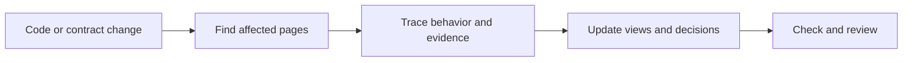

# Archlens

[](https://github.com/tushar-mahalya/archlens/actions/workflows/ci.yml)
[](https://scorecard.dev/viewer/?uri=github.com/tushar-mahalya/archlens)
[](https://github.com/tushar-mahalya/archlens/releases/latest)
[](LICENSE)

**Understand how a project works, how its data moves, and why its design exists.**

Archlens is an Agent Skill and Claude Code plugin for clear, evidence-based architecture documents.
It uses Mermaid diagrams, decision records, and a writing style inspired by Simplified Technical English.
It updates the pages affected by a change instead of regenerating a large wiki.

## Install for Claude Code

You need a current [Claude Code](https://code.claude.com/docs/en/quickstart) installation and Git.
Run these commands **inside Claude Code**:

```text
/plugin marketplace add tushar-mahalya/archlens
/plugin install archlens@archlens
```

Choose **user scope** to use Archlens across your projects on this machine.
Reload plugins or restart Claude Code if it asks you to.
Then open the project you want to understand and run:

```text
/archlens:setup
```

No separate API key, Python installation, Node installation, or server is required for these commands.
Claude Code's normal subscription or API usage still applies.

## Install for other coding agents

The portable [Agent Skill](https://agentskills.io/) works with compatible hosts.
Install it in the current project with Node.js 22.20+ and Git:

```text
npx skills@1.7.6 add tushar-mahalya/archlens --skill archlens --agent codex --copy --yes
```

Replace `codex` with your agent selector, or add `--global` for a user-level installation.
For example, the installer also supports `cursor`, `github-copilot`, `gemini-cli`,
`opencode`, `roo`, `devin`, and `claude-code`.
The [installation guide](docs/installation.md) covers tested adapters, host-specific limits,
updates, Cline and Windsurf caveats, and installer privacy.

Open a new agent session and ask, for example:

> Use the Archlens skill to set up architecture documentation for this project.

You can also ask Archlens to update, check, explain, or draft a decision.
Portable hosts can load the description at startup and choose when to invoke the skill;
they do not necessarily provide Claude's isolated, manual-only behavior.
For Claude Code, choose either the native plugin above or the portable skill, not both.

## Five Claude Code commands

| Command | What it does | Changes files? |
|---|---|---|
| `/archlens:setup` | Creates a small handbook from source evidence | Documentation only |
| `/archlens:update main` | Reviews branch and working-tree changes; updates affected views | Documentation only |
| `/archlens:check` | Checks documents, evidence, coverage, and clarity | No |
| `/archlens:explain order submission` | Traces a named scenario with a diagram and source links | No |
| `/archlens:decide use a durable queue` | Drafts a decision record with options and tradeoffs | Documentation only |

Replace `main` with your actual local base ref.
Without a ref, `update` reviews working-tree changes only.
Supply decision evidence explicitly: an isolated task does not receive your earlier conversation.

## What you get

```text
docs/architecture/
  README.md        Reading path, coverage, and known gaps
  context.md       Users, boundaries, and external systems
  containers.md    Main units and responsibilities
  runtime/         Important execution paths and failure behavior
  data/            Ownership, transformations, and lifecycle
  decisions/       Design choices, alternatives, and consequences
  glossary.md      Consistent project terms
  map.json         Source-to-document review map
```

Archlens starts small. It does not create every page or claim to trace every possible execution.
It reuses an existing documentation layout where practical.



Read the [working example](examples/order-service/README.md) to see the result before you install.

## Designed for small context

- **Native Claude plugin:** manual invocation and a forked task keep exploration outside the parent conversation.
- **Portable skill:** a small router loads one workflow and the shared contract; discovery and isolation depend on the host.
- **Conditional references:** commands read only the rules and template sections they need.
- **Bounded tool output:** optional checker summaries have a tested 6,000-byte limit with explicit omission counts.
- **No always-on hooks, custom agents, MCP servers, eager imports, or shell injection.**
- **Size tests:** CI rejects oversized command prompts and shared instructions.

Current native command bodies plus the shared contract are roughly 850-1,030 tokens using a bytes/4 estimate.
This is **not measured model token usage**. Source reads, task-specific references, host instructions, and outputs are additional.
Isolation reduces parent-context growth; it does not make the worker free.

See [context architecture and budgets](docs/context-efficiency.md), including limits and a real-task measurement plan.

## Global preferences

Create `~/.config/archlens/config.json` to share defaults across compatible agents:

```json
{
  "docsRoot": "docs/architecture",
  "styleTarget": 0.8,
  "maxDiagramNodes": 12,
  "maxSequenceParticipants": 7
}
```

A project's `.archlens.json` overrides these values.
You can select another user config with `ARCHLENS_CONFIG`; existing Claude-specific
preferences remain supported. These are Archlens conventions, not host settings.
See [configuration](docs/configuration.md).

## Optional local checks

With Python 3.10+ and a clone of this repository:

```text
python plugins/archlens/scripts/archlens.py check --root /path/to/project
python plugins/archlens/scripts/archlens.py impact --root /path/to/project --base main
python plugins/archlens/scripts/archlens.py config --root /path/to/project --json
```

On Windows, use a quoted Windows path such as `"C:\work\my-project"`.
Use `python3` or `py -3` in place of `python` if that is how Python 3.10+ is installed.
The Python tool has no third-party dependencies and does not edit your project.
Use `--summary` for bounded JSON or `--json` for the complete report.
The [CLI reference](docs/cli.md) explains checks, exit codes, and limitations.

## Trust and limits

- The writing target is **STE-inspired**, not official ASD-STE100 certification.
- Code proves implementation, not undocumented human intent.
- Proposed decisions need human approval.
- Rendered diagrams can still be wrong. Check them against evidence.
- The optional checker does not render Mermaid or calculate an STE score.
- Archlens itself has no telemetry or remote rendering. The skills installer has separate
  network and telemetry behavior; your agent processes content under its provider's policy.
- Instructions guide behavior; they are not a security sandbox. Normal permissions still apply.

## More help

- [Installation, updates, removal, and troubleshooting](docs/installation.md)
- [Documentation method and research](docs/methodology.md)
- [How Archlens works](docs/architecture/README.md)
- [Contributing and tests](CONTRIBUTING.md)
- [Questions and support](SUPPORT.md) and [Discussions](https://github.com/tushar-mahalya/archlens/discussions)
- [Code of Conduct](CODE_OF_CONDUCT.md), [governance](GOVERNANCE.md), and [security policy](SECURITY.md)
- [Release notes](CHANGELOG.md)

MIT licensed. Independent project; not affiliated with Anthropic or ASD.
