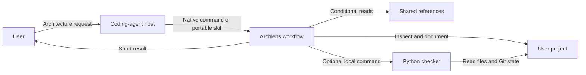

# Understand Archlens

Archlens provides a Claude Code plugin, a portable Agent Skill, and a local checker.
Claude Code runs six plugin commands. Five run in isolated tasks, so exploration stays out of
the main conversation. `learn` runs inline so the user can ask follow-up questions.
Plugin hooks load a compact handbook map, point to pages, flag stale pages,
and hold an agent's commit once so stale pages are updated in the same commit.
The portable skill routes the same operations in other hosts. Isolation depends on the host.
The checker reads local files and Git state without calling a model.

## Context and main units

The coding agent and the user's project are outside Archlens's implementation boundary.
The skill is instructions, not a separate security sandbox.
There is no Archlens server or database.

| Unit | Responsibility | Source |
|---|---|---|
| Marketplace | Locate the installable plugin | [Catalog](../../.claude-plugin/marketplace.json) |
| Plugin manifest | Name, version, and distribution metadata | [Manifest](../../plugins/archlens/.claude-plugin/plugin.json) |
| Native skills | Select one isolated Claude workflow | [Commands](../../plugins/archlens/skills) |
| Plugin hooks | Load the map at session start, point to pages, flag stale pages at stop, hold stale commits | [Hooks](../../plugins/archlens/hooks/hooks.json) |
| Portable skill | Route one operation for compatible hosts | [Portable skill](../../skills/archlens/SKILL.md) |
| Generator | Keep portable resources aligned with the native plugin | [Sync tool](../../tools/sync_portable.py) |
| References | Evidence, config, writing, and page conventions | [References](../../plugins/archlens/references) |
| Checker | Config, structural checks, freshness, sync, context map, impact, hooks | [Python tool](../../plugins/archlens/scripts/archlens.py) |
| Budget check | Prevent instruction growth and eager-loading additions | [Budget tool](../../tools/prompt_budget.py) |

## Reading path and coverage

| Question | Page | Known limit |
|---|---|---|
| How do the plugin and portable skill stay identical? | [Distribution](distribution.md) | Host discovery varies by agent |
| How does the handbook stay current? | [Freshness runtime](runtime.md) | Stale flags are path-level, not semantic |
| Where do settings and reports go? | [Data](data.md) | The host's internal data handling is outside this project |
| Why manual isolated commands? | [ADR-001](decisions/ADR-001.md) | Real model token savings remain unmeasured |
| Why JSON metadata? | [ADR-002](decisions/ADR-002.md) | Authors must maintain coverage patterns |
| Why a passive map and fingerprints? | [ADR-003](decisions/ADR-003.md) | The map costs context in every session |
| What does prompt loading cost? | [Context budgets](../context-efficiency.md) | Byte estimates are not exact tokens |
| How does it compare with alternatives? | [Benchmarks](../benchmarks.md) | Small question set; one repository |

**Implementation observed:** links above.
**Test evidence:** [checker tests](../../tests/test_archlens.py#L236-L313),
[distribution tests](../../tests/test_distribution.py), and
[installer tests](../../tests/test-skills-install.mjs).
These documents are drafts. No human review is claimed.
