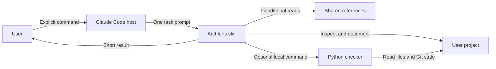

# Understand Archlens

Archlens is a Claude Code plugin plus an optional local checker.
The host runs five explicit commands in isolated task contexts.
The checker reads local files and Git state without calling a model.

## Context and main units

Claude Code and the user's project are outside Archlens's implementation boundary.
The skill is instructions, not a separate security sandbox.
There is no Archlens server or database.

| Unit | Responsibility | Source |
|---|---|---|
| Marketplace | Locate the installable plugin | [Catalog](../../.claude-plugin/marketplace.json) |
| Plugin manifest | Name, version, and distribution metadata | [Manifest](../../plugins/archlens/.claude-plugin/plugin.json) |
| Skills | Select one workflow and control reference loading | [Commands](../../plugins/archlens/skills) |
| References | Evidence, config, writing, and page conventions | [References](../../plugins/archlens/references) |
| Checker | Config validation, structural checks, impact reports | [Python tool](../../plugins/archlens/scripts/archlens.py) |
| Budget check | Prevent instruction growth and eager-loading additions | [Budget tool](../../tools/prompt_budget.py) |

## Reading path and coverage

| Question | Page | Known limit |
|---|---|---|
| How does update select pages? | [Update runtime](runtime.md) | Indirect dependencies require agent review |
| Where do settings and reports go? | [Data](data.md) | The host's internal data handling is outside this project |
| Why manual isolated commands? | [ADR-001](decisions/ADR-001.md) | Real model token savings remain unmeasured |
| Why JSON metadata? | [ADR-002](decisions/ADR-002.md) | Authors must maintain coverage patterns |
| What does prompt loading cost? | [Context budgets](../context-efficiency.md) | Byte estimates are not exact tokens |

**Implementation observed:** links above.
**Test evidence:** [checker tests](../../tests/test_archlens.py) and [distribution tests](../../tests/test_distribution.py).
These documents are drafts. No human review is claimed.
