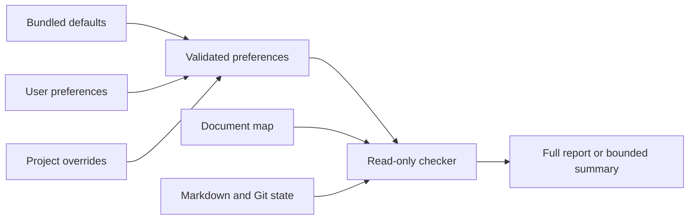

# What data does Archlens use?

Archlens stores no central project database.
The user's handbook and map hold durable documentation.
Reports are transient output unless the user or task saves them locally.

Later preference layers replace earlier keys. One selected user preference file
may be shared across agents. Project preferences override it.
The checker rejects unknown keys and duplicate JSON keys.

| Data | Owner | Lifetime and access |
|---|---|---|
| Skill resources | Project maintainer | Installed and updated by the selected distribution |
| User preferences | User | Local config file until the user removes it |
| Project preferences | Project team | Version or ignore according to team policy |
| Handbook and map | Project team | Normal repository history and review |
| Checker reports | Caller | Standard output, or an explicitly saved local file |
| Agent context | Coding-agent host/provider | Governed by the host and provider policy |

The checker uses no network API and sends no telemetry.
This does not imply that the coding agent runs a local language model.
Source content selected by the agent follows the host's provider and retention policy.

**Implementation observed:** [config and reports](../../plugins/archlens/scripts/archlens.py).
**Unknown:** any particular user's provider policy, storage encryption, or backup settings.
