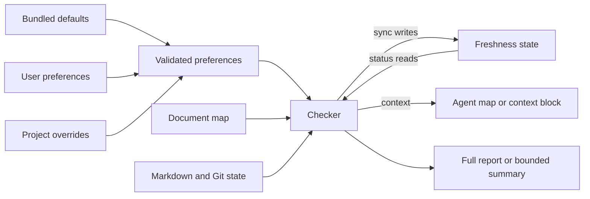

# What data does Archlens use?

Archlens stores no central project database.
The user's handbook, map, and freshness state hold durable documentation data.
Reports are transient output unless the user or task saves them locally.

Later preference layers replace earlier keys. One selected user preference file
may be shared across agents. Project preferences override it.
The checker rejects unknown keys and duplicate JSON keys.

| Data | Owner | Lifetime and access |
|---|---|---|
| Skill resources | Project maintainer | Installed and updated by the selected distribution |
| User preferences | User | Local config file until the user removes it |
| Project preferences | Project team | Version or ignore according to team policy |
| Handbook and map | Project team | Normal repository history and review |
| `.archlens-state.json` | Project team | Committed beside the map; rewritten only by `sync` |
| Context block in `contextFile` | Project team | Rewritten by `sync` or `context --write`; text outside the block is kept |
| Hook markers | Local user | Per session: the starting commit, the last reminder and commit-hold hashes, and pages already pointed to; in the plugin data folder or a private temp folder |
| Checker reports | Caller | Standard output, or an explicitly saved local file |
| Agent context | Coding-agent host/provider | Governed by the host and provider policy |

The state file maps each page ID to short Git-compatible content IDs of its covered
and linked files, plus the sync time and commit. Each cited line range also has a
fingerprint: a hash of the enclosing function or class (Python syntax tree, or comment-free
C-family code), plus a hash of the range's own code lines when it sits inside a larger symbol,
or of the normalized text otherwise. Whole-file links to code also record a short hash of each
of the file's declared names, and a page also follows Git-reported file renames. It holds no file content.
The checker uses no network API and sends no telemetry.
Source content selected by the agent follows the host's provider and retention policy.

**Implementation observed:** [config, state, and reports](../../plugins/archlens/scripts/archlens.py).
**Unknown:** any particular user's provider policy, storage encryption, or backup settings.
