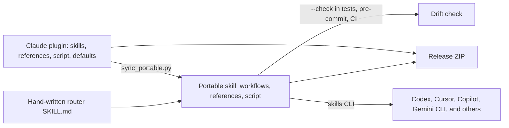

# How does one source become a plugin and a portable skill?

The Claude plugin in `plugins/archlens/` is the single source of truth.
A generator copies it into the portable Agent Skill in `skills/archlens/`.
Tests, pre-commit, and CI fail when the two copies drift.

## Generation rules

The generator is [`tools/sync_portable.py`](../../tools/sync_portable.py).

| Input | Output | Change |
|---|---|---|
| `plugins/archlens/skills/<op>/SKILL.md` | `skills/archlens/workflows/<op>.md` | Drops frontmatter. Replaces `${CLAUDE_PLUGIN_ROOT}` with `<skill-dir>` and `$ARGUMENTS` with "the relevant part of the user's request" |
| `/archlens:setup` in a command | Same workflow | Becomes "the Archlens setup operation" |
| Claude-only sentences, such as the session map | Same workflow | Reworded for hosts without plugin hooks |
| `references/*.md`, `scripts/archlens.py`, `defaults.json`, `LICENSE` | Same paths | Copied byte for byte |
| Router `skills/archlens/SKILL.md` | Not generated | Maintained by hand; links each workflow once |

`--check` reports missing, stale, unexpected, and symlinked resources without writing.
It refuses to write through a symlink.

## Enforcement and release

| Gate | What it checks | Evidence |
|---|---|---|
| Unit tests | Generated files match; no Claude placeholders remain | [Distribution tests](../../tests/test_distribution.py) |
| Pre-commit and CI | `sync_portable.py --check` and prompt budgets | [CI workflow](../../.github/workflows/ci.yml) |
| Installer test | The skills CLI installs the bundle for ten agents, project and global | [Installer test](../../tests/test-skills-install.mjs) |
| Release | Reproducible, allowlisted ZIP with fixed timestamps and a SHA-256 sum | [Release packager](../../tools/package_release.py) |

The plugin hooks exist only in the Claude plugin. Portable hosts use the
`contextFile` block, pre-commit hooks, or CI instead. See the [freshness runtime](runtime.md).
