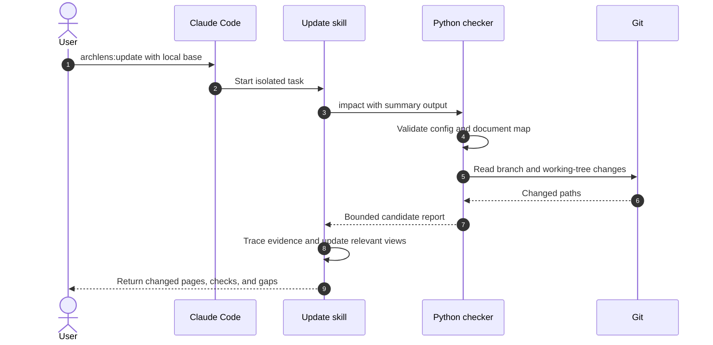

# How does update select documents?

The user invokes update with an optional local base ref.
The checker selects candidate pages by source path.
The task then checks semantics and indirect consumers before changing documents.

If Python is absent, the task uses Git and the map directly.
It states that deterministic checks were unavailable.
If the checker fails, the task reports the error instead of hiding it with a fallback.

| Condition | Behavior | Evidence |
|---|---|---|
| Base ref supplied | Resolve it, find merge base, inspect committed changes | [changed_files](../../plugins/archlens/scripts/archlens.py) |
| No base | Inspect working tree only | [changed_files](../../plugins/archlens/scripts/archlens.py) |
| Source path matches coverage | Return the page as a candidate | [impact_report](../../plugins/archlens/scripts/archlens.py) |
| Page also changed | Keep it in the candidate report | [Impact tests](../../tests/test_archlens.py) |
| No map or invalid config | Exit 2 with an explicit error | [CLI](../../plugins/archlens/scripts/archlens.py) |
| Preview cannot fit all records | Return totals and omitted counts | [bounded_report](../../plugins/archlens/scripts/archlens.py) |

No automatic retry, remote fetch, or mutation occurs in the checker.
The host's tool permissions control the agent's writes.
The skill requires source evidence before treating a candidate as stale.
