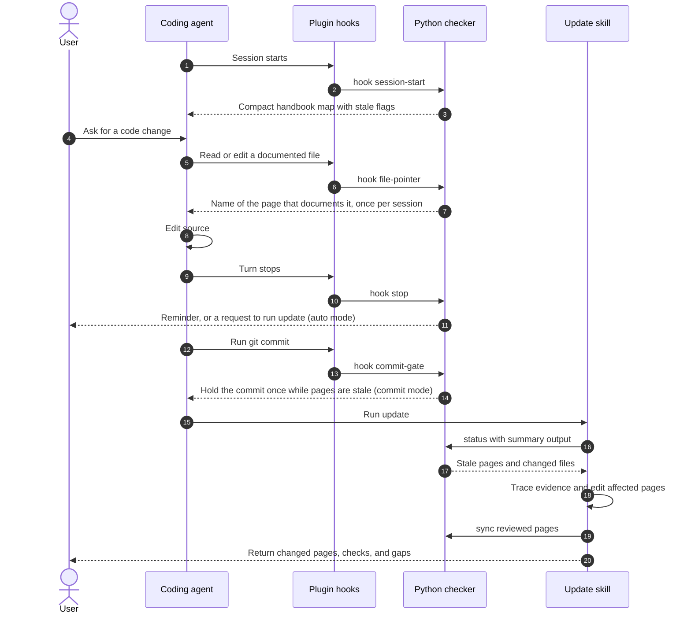

# How does the handbook stay current?

Archlens records what each page was last checked against.
It flags a page as stale when the evidence the page cites changes, and for review
when only other covered files change. An agent then fixes those pages and records the new baseline.

The map comes from `map.json`, page titles, and first sentences.
It stays within `contextBudget` bytes and loads only where a handbook exists.
In other projects, both hooks print nothing.

| Condition | Behavior | Evidence |
|---|---|---|
| The function or class around a cited line range changed (Python or C-family), or a linked non-code file changed | Page is stale | [page_changes](../../plugins/archlens/scripts/archlens.py) |
| A cited range sits inside a larger function, and only other lines of that function changed | Not stale; the range's own code lines still match | [check_anchor](../../plugins/archlens/scripts/archlens.py) |
| A whole-file link to code: only bodies changed, or the declared names changed | Review, or stale when names were added, removed, or renamed | [outline](../../plugins/archlens/scripts/archlens.py) |
| A cited function or text block moved | Stop hook rewrites the line link without a model; `fix-anchors` does the same on demand | [fix_anchors](../../plugins/archlens/scripts/archlens.py) |
| Only other covered files changed, or comments and formatting inside cited code | Page needs review, not stale | [Anchor tests](../../tests/test_archlens.py#L648-L771) |
| Change was already committed | Still stale; content IDs do not depend on a base ref | [Freshness tests](../../tests/test_archlens.py#L465-L645) |
| Same stale set seen in this session | Stop hook stays silent | [hook_stop](../../plugins/archlens/scripts/archlens.py) |
| `autoUpdate` is `auto` and the hook has not already blocked | Agent is asked to run update | [hook_stop](../../plugins/archlens/scripts/archlens.py) |
| `autoUpdate` is `commit` (default) or `auto`, and an agent `git commit` would leave pages stale | Commit is held once; the agent updates the pages, stages them, and commits again | [hook_commit](../../plugins/archlens/scripts/archlens.py) |
| `contextFile` is set | Sync rewrites the managed block, without stale flags | [write_context](../../plugins/archlens/scripts/archlens.py) |
| The agent committed during the session | Stop hook also compares against the session's starting commit | [hook_stop](../../plugins/archlens/scripts/archlens.py) |
| Base ref supplied to update | Impact report adds branch changes and uncovered files | [impact_report](../../plugins/archlens/scripts/archlens.py) |
| Hook input or configuration is invalid | Hook exits 0 with no output | [run_hook](../../plugins/archlens/scripts/archlens.py) |

If Python is absent, the skills use Git and the map directly and state that limit.
Portable hosts do not run the plugin hooks. They use the `contextFile` block,
the [pre-commit hooks](../../.pre-commit-hooks.yaml), or CI for the same signals.
A stale flag is a review candidate. It does not prove that the prose is wrong.
