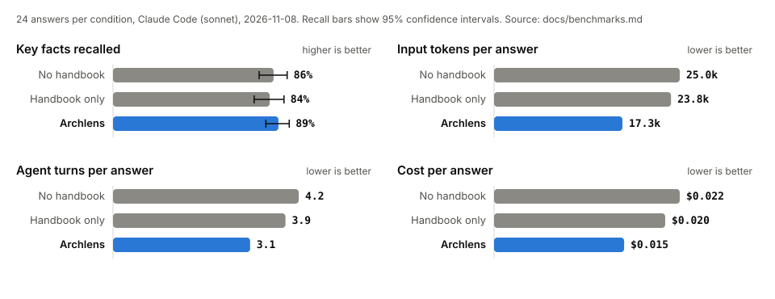

# Benchmarks

Three questions matter for a documentation skill:

1. **Context cost.** How much does it add to every session, and to each task?
2. **Speed at scale.** Can drift detection run after every agent turn?
3. **Answer quality.** Do agents answer project questions better or cheaper with it?

All numbers below come from scripts in this repository. Rerun them before you rely on them.

## 1. How Archlens compares

Reviewed on 8 November 2026 from each project's own documentation and files.
Star counts and vendor claims are as published, not verified by us.

| Tool | How it stays current | Always-loaded cost | Accuracy safeguards | Agents |
|---|---|---|---|---|
| **Archlens** | Local fingerprints of cited functions, line ranges, and covered files. Hooks, pre-commit, or CI flag drift; an isolated task rewrites | 178 B description, plus a map of at most 3 KB only where a handbook exists | Evidence links, symbol-level drift, moved-anchor detection, stale prose references, "unknown" rule | Claude plugin with hooks; portable skill; `AGENTS.md` block |
| [OpenWiki](https://github.com/langchain-ai/openwiki) | Claims tied to line-range evidence; clean updates skip model work. Manual run or scheduled CI PR | A managed `AGENTS.md` block; size not stated | Grounded claims with versioned evidence | Runs through the host agent's session or its own provider |
| [repowise](https://github.com/repowise-dev/repowise) | Per-commit incremental index; path, symbol, and command drift checks | Up to 10 MCP tools | Symbol findings need proof from Git | MCP clients |
| [Fiberplane drift](https://github.com/fiberplane/drift) | Doc anchors to `file#Symbol` with a normalized AST hash; CI fails when stale | Near zero | Symbol-level, ignores reformatting | Skill; detection only |
| [Swimm](https://docs.swimm.io/) | Docs coupled to code snippets and tokens; auto-sync check on PRs | Not stated | Element-level coupling | IDE and MCP; commercial |
| [deepwiki-skill](https://github.com/natsu1211/deepwiki-skill) | Model-driven `--update` | About 526 B descriptions; 3.7 KB skill plus up to 70 KB references per task | Line citations, Mermaid validation | Skill hosts |
| [claude-code-auto-memory](https://github.com/severity1/claude-code-auto-memory) | Starts an updater agent at turn end whenever files changed | About 784 B descriptions plus managed `CLAUDE.md` sections | None stated | Claude Code |
| [DeepWiki](https://docs.devin.ai/work-with-devin/deepwiki) | Hosted regeneration | MCP tools, on demand | Code links; users report stale and wrong pages | Web and MCP |
| [Aider repo map](https://aider.chat/docs/repomap.html), [CodeGraph](https://github.com/colbymchenry/codegraph), [Serena](https://github.com/oraios/serena) | Recomputed from code | Symbol maps or MCP tools | Deterministic, but no rationale or design history | Varies |

What Archlens does that none of the reviewed tools combine: a hard always-loaded budget
enforced in CI, model-free drift detection on cited symbols, published answer-quality
benchmarks including a failed run, and a built-in tutor for the human (`/archlens:learn`).

Where others are ahead: OpenWiki and repowise have far larger communities;
code-graph tools answer "who calls this" questions that a handbook does not;
Swimm couples individual tokens, not just functions and line ranges.

## 2. Speed at scale

`python tools/benchmark.py` builds synthetic Git repositories, syncs every page,
changes 25 files, and times each operation (median of three runs).
Apple Silicon laptop, Python 3.9.6.

| Synthetic repo | sync | status | context | Stop hook | check | Map bytes | State file |
|---|---:|---:|---:|---:|---:|---:|---:|
| 1,000 files, 20 pages | 63 ms | 49 ms | 51 ms | 82 ms | 11 ms | 2,069 | 36,215 |
| 10,000 files, 100 pages | 92 ms | 83 ms | 89 ms | 117 ms | 36 ms | 2,510 | 357,086 |
| 50,000 files, 300 pages | 257 ms | 222 ms | 245 ms | 328 ms | 75 ms | 2,982 | 1,828,468 |

Every synthetic page cites a line-range anchor, so these times include anchor checks.
The map stays inside its 3,000-byte budget at 300 pages: it drops summaries first,
then coverage, then lists how many pages it left out.
The first implementation scanned every file for every page and took 4.1 s at 50,000 files.
Sorted prefix ranges cut that to about 0.3 s, fast enough for a per-turn hook.

| Session map | Bytes | ~Tokens | Handbook bytes | Map / handbook |
|---|---:|---:|---:|---:|
| This repository | 1,630 | 408 | 17,591 | 9.3% |
| Order example | 1,131 | 283 | 7,379 | 15.3% |

## 3. Answer quality and cost with real agent sessions

`python tools/model_benchmark.py` copies one snapshot of this repository into three workspaces
and asks Claude Code (Sonnet, read-only tools: Read, Grep, Glob) eight architecture questions,
three times each, under each condition:

- **no-handbook:** `docs/architecture/` removed. The other docs remain.
- **handbook:** the handbook exists, but nothing tells the agent about it.
- **archlens:** the handbook plus the Archlens plugin, which loads the page map at session start.

A separate Sonnet call grades each answer blind against a fixed answer key
([questions and keys](../benchmarks/questions/archlens.json)). User settings, plugins,
and MCP servers are excluded from every session. Raw answers, grades, and usage are in
[`benchmarks/results/model-sonnet.json`](../benchmarks/results/model-sonnet.json).

| Condition | Key-fact recall (95% CI) | Wrong claims / answer | Input tokens | Uncached input | Output | Turns | Cost | Time |
|---|---:|---:|---:|---:|---:|---:|---:|---:|
| no-handbook | 86% (79%-94%) | 0.12 | 24,952 | 4,184 | 861 | 4.2 | $0.022 | 9.6 s |
| handbook | 84% (76%-92%) | 0 | 23,778 | 3,493 | 858 | 3.9 | $0.020 | 9.3 s |
| archlens | 89% (82%-95%) | 0.04 | 17,253 | 2,579 | 651 | 3.1 | $0.015 | 7.0 s |



**Result:** with Archlens, answers were at least as good (the intervals overlap) and used
31% fewer input tokens, 26% fewer turns, 32% less cost, and 27% less time than without a handbook.
A handbook alone saved almost nothing: the agent rarely looked for it.
This matches Vercel's finding that always-loaded context beats on-demand discovery.
The `archlens` sessions also had the file-pointer hook, which names a file's page when the agent opens it.

| Question | no-handbook | handbook | archlens |
|---|---:|---:|---:|
| config-order | 100% | 100% | 100% |
| hook-safety | 100% | 100% | 78% |
| isolation | 83% | 92% | 75% |
| json-map | 92% | 67% | 100% |
| other-agents | 58% | 75% | 100% |
| portable-sync | 92% | 75% | 100% |
| staleness | 67% | 67% | 60% |
| summary-limit | 100% | 100% | 100% |

The first grading used an answer key written before the `review` tier existed, so the judge
marked correct statements about it as wrong. We corrected the key and re-graded every stored
answer with `--rejudge`; no session was re-run. Grades moved by up to 4 points per condition,
which shows the size of judge noise.

### What the first run taught us

The first version of the map said "read pages before source".
Agents then treated a page summary as the whole answer. One answer said it had
"only read the README" and had not opened the generator. Recall fell to 80%,
against 90% without a handbook ([raw run](../benchmarks/results/model-sonnet-map-v1.json)).
Two fixes closed the gap:

1. The map now says that pages summarize and source is authoritative.
2. The run exposed a real coverage gap. This handbook had only one table row about
   how the portable skill is generated. A [distribution page](architecture/distribution.md)
   now covers it, and `portable-sync` recall rose from 17% to 100%.

A thin page can make an agent less thorough than no page.
Keep coverage gaps listed in the index, and keep summaries accurate.

### Limits

- One small repository (about 100 files). Agents can search it quickly without help,
  so savings on large repositories are likely larger, but they are not measured here.
- 24 answers per condition. Differences in recall below about 8 points are noise.
- The judge is a model. It is blind to the condition, but it can be strict or lenient.
- Questions are about architecture and rationale. This does not measure coding tasks.
- The final run cost $1.36 for 72 answers, plus about $0.30 for each grading pass.

## Rerun

```text
python tools/benchmark.py
python tools/model_benchmark.py --questions benchmarks/questions/archlens.json --reps 3
python tools/model_benchmark.py --report benchmarks/results/model-sonnet.json
python tools/render_charts.py
```

Use `--repo` and your own question file to benchmark another project with a handbook.
The model benchmark spends real usage; start with `--reps 1`.
