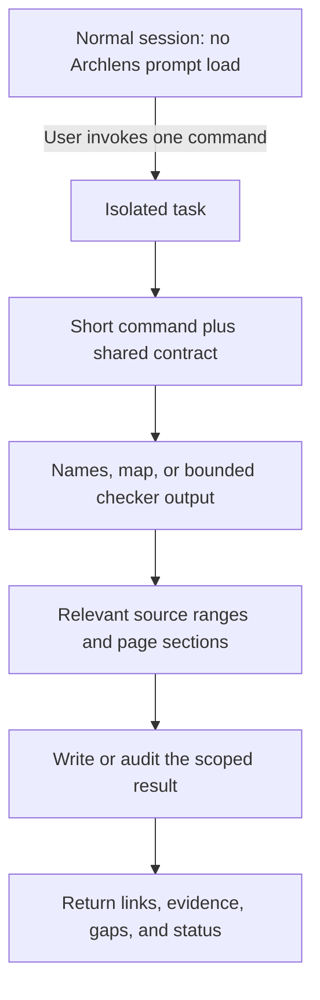

# Context architecture and budgets

## Goal

Minimize unnecessary instruction and tool-output tokens without sacrificing evidence.
Measure parent-context growth and total task usage separately.
We do not claim a universal percentage saving or "best-in-class" performance without comparative evaluation.

## Verified host behavior

Research checked on 6 November 2026:

1. [Claude skills](https://code.claude.com/docs/en/skills#control-who-invokes-a-skill):
   `disable-model-invocation: true` excludes the description from normal model context.
2. [Skill lifecycle](https://code.claude.com/docs/en/skills#skill-content-lifecycle):
   an inline skill stays in context. Re-invocation with different rendered content can append another full copy.
3. [Forked skills](https://code.claude.com/docs/en/skills#run-skills-in-a-subagent):
   a skill can run as an isolated task without the parent conversation.
4. [Subagents](https://code.claude.com/docs/en/sub-agents):
   separate tasks still use tokens. Custom agent descriptions can add startup context.
5. [Memory imports](https://code.claude.com/docs/en/memory#import-additional-files):
   `@` imports load eagerly with their parent file.
6. [Agent Skills authoring](https://agentskills.io/skill-creation/best-practices):
   use coherent tasks, moderate detail, explicit loading conditions, and execution-based evaluation.

These are host capabilities, not guarantees that an LLM follows every read budget.

## Our choices



The diagram shows logical loading, not literal removal of tokens from an active worker.

| Layer | Loading rule | Constraint |
|---|---|---|
| Discovery | Manual commands only | No auto-invocable skill or custom agent descriptions |
| Command | One task, one fork | At most 2,600 UTF-8 bytes per skill |
| Shared contract | Once within that task | At most 2,400 bytes |
| Base instructions | Command plus contract | At most 5,000 bytes |
| Detailed references | Named section only when required | No blanket "read every reference" instruction |
| Tool report | Compact first | At most 6,000 bytes with omission counts |
| Source evidence | Names, then selected ranges | Expand only for a named missing fact |
| Parent result | Links and conclusions | 200 words; explain can use 500 |

CI checks byte budgets, routes, resource paths, and forbidden eager-loading surfaces.
It also counts setup's required configuration and workflow sections, and decide's ADR frame.
The cold-load limits are 10,500 bytes for setup, 6,500 for decide, and 5,000 for the other commands.
These limits exclude conditional source reads and template sections selected later in the task.
It also tests report limits with oversized synthetic inputs.
It does not pretend that bytes are exact tokens.
The `roughBaseTokens` figure is `ceil(bytes / 4)` for planning only.

## Per-command loading

| Command | Always read | Conditional reads |
|---|---|---|
| setup | Contract, configuration | Coverage and trace sections; one template section per new page |
| update | Contract | Configuration only without Python or for map edits; specific trace/template sections |
| check | Contract | Config fallback; writing rubric only for an explicitly requested style audit |
| explain | Contract | Config only to locate a custom handbook; relevant implementation |
| decide | Contract, ADR template section | Effective config; map section for registration |

The entire workflow, style manual, and template catalog are not default input for every command.
The method guide and research citations are for users, not loaded into skills.

## Why these choices matter

### Execute checks instead of narrating their implementation

The worker runs the Python tool. It does not read hundreds of lines of checker source.
Ordinary findings are data, not another instruction document.
Large reports stay on disk; the worker queries selected records.
Omission counts prevent a compact preview from masquerading as complete coverage.

### Isolate only one coherent task

Each user command starts one forked task. The plugin does not build an agent tree.
This limits duplicate setup and repeated instructions.
We use the host's general-purpose agent rather than registering more always-discoverable agents.
Normal repository guidance and permissions remain in effect.

For a tiny question, a normal chat answer can be cheaper than starting Archlens.
The commands are intended for evidence-backed architecture work, not every code lookup.

### Do not promise magical offloading

A file read still costs tokens. A separate reference does not help if every command always reads it.
Once text enters a worker, Archlens cannot force the host to evict it.
The isolation boundary ends the task; it is not an unlimited memory or cache mechanism.
Compaction and prompt caching are controlled by Claude Code and its provider.
Cached input can reduce billing without reducing context size.

### Persist knowledge, not full transcripts

Handbook pages, source links, and map entries are reusable outputs.
On the next invocation, the worker reads only relevant current evidence.
It does not receive the old exploration transcript or a growing auto-memory file.
Do not use stale summaries as proof that source behavior is unchanged.

## Measurement and acceptance

Run:

```text
python tools/prompt_budget.py
python -m unittest discover -s tests -v
```

For a real model evaluation, use the same project revision, model, permissions, and tasks:

1. Setup on the order example.
2. Explain duplicate-key handling.
3. Update after a contract change.
4. Check a deliberately broken link and an incorrect runtime branch.
5. Draft a decision with missing approval evidence.
6. Repeat check with a large synthetic handbook.

Compare a fresh baseline without Archlens, this version, and any proposed prompt change.
Record input/output tokens, cached tokens separately, tool-output volume, latency,
loaded references, files changed, missed facts, and false claims.
Repeat runs; keep quality requirements fixed.
Use `/context` for host context inspection and available usage records for actual token accounting.

Accept an optimization only if it preserves evidence, failure coverage, approval handling,
and report completeness. A smaller prompt that misses a changed consumer is not an improvement.

Local tests validate static base and cold-load budgets, plus bounded reports.
Model-task token totals and comparative quality are not yet measured.
Host plugin validation and install tests do not substitute for these model evaluations.
