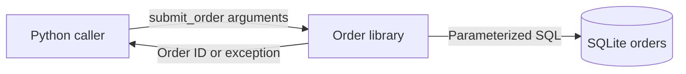

# What are the main parts?

The caller runs in the same process as the order library.
The library stores orders through a SQLite connection.
No external service takes part.

The arrows show calls and results, not network connections.

| Unit | Responsibility | Evidence |
|---|---|---|
| Caller | Supplies request key, SKU, and quantity | [Demo](../../order_service.py) |
| Order library | Validates input and detects repeated requests | [submit_order](../../order_service.py#L20-L38) |
| SQLite | Stores records and enforces a unique request key | [connect](../../order_service.py#L10-L17) |

**Implementation observed:** this structure follows the example source.
**Unknown:** any production deployment, authentication boundary, or operating owner.

Next: [trace submission](runtime/submit-order.md).
