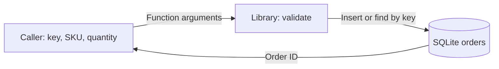
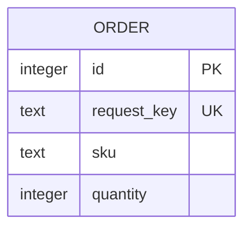

# Where does order data go?

The caller supplies the input. The library validates it.
SQLite holds the authoritative order record within this example.

The result contains an ID, not a complete order object.

| Field | Rule | Owner |
|---|---|---|
| ID | SQLite assigns the primary key | Order library |
| Request key | Non-empty string; unique in the store | Caller supplies it |
| SKU | Non-empty string | Caller supplies it |
| Quantity | Positive integer; booleans are rejected | Caller supplies it |

The demo uses an in-memory database. Closing it destroys the data.
A caller can pass a file path to `connect` for persistence.
The example has no deletion API, retention job, backups, access control, or schema migration process.

**Implementation observed:** [schema and write path](../../order_service.py).
**Unknown:** production retention, data classification, and recovery objectives.

Related: [request-key decision proposal](decisions/ADR-001.md).
