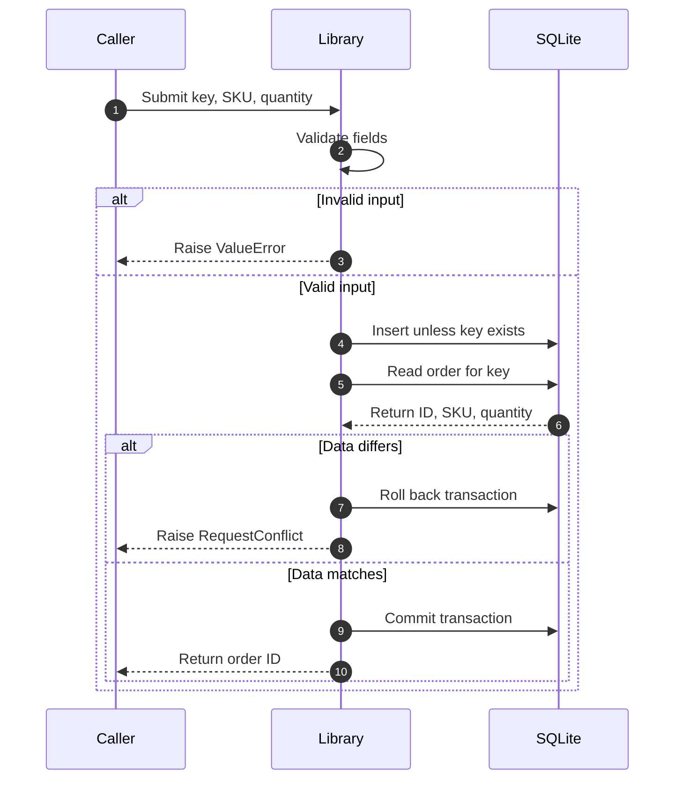

# What happens when the caller submits an order?

The library validates the input before it starts a write.
It creates an order or finds the order with the same request key.
It rejects a repeated key whose SKU or quantity differs.

The diagram omits SQLite exceptions. The function propagates those exceptions to the caller.
The connection context rolls back an active transaction when an exception escapes it.

| Rule order | Condition | Result | Side effect |
|---|---|---|---|
| 1 | Empty or non-string key | ValueError | None |
| 2 | Empty or non-string SKU | ValueError | None |
| 3 | Quantity is not a positive integer | ValueError | None |
| 4 | Existing key has different data | RequestConflict | Transaction rolls back |
| 5 | New key or matching repeated key | Order ID | New record commits, or existing record remains |

Input validation uses this order. A boolean quantity is not an integer for this API.
There is no automatic retry. The caller must handle storage failures.

**Implementation observed:** [submit_order](../../../order_service.py#L20-L38).
The unique constraint and conflict clause prevent two stored rows with the same key.
This does not establish a general exactly-once guarantee for a distributed system.

Next: [data ownership and lifetime](../data.md).
